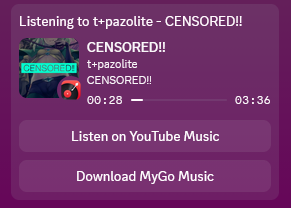

# Discord Rich Presence for MyGo Music

Unofficial **Discord Rich Presence (RPC)** plugin for [MyGo Music](https://github.com/egoist/mygo-music).  
Runs out-of-the-box with **zero external dependencies**

## Preview

## Quick Start

> [!IMPORTANT]
> **Activating Rich Presence**:  
> Each time you start MyGo, open **Discord Status** once from the source menu in the top-left. After the helper starts, switch back to the NetEase Cloud Music source (or your preferred source like YouTube Music, Spotify, etc.) and play a track.

1. In MyGo Music, go to **Settings > Plugins** and enable **Discord Rich Presence**.
2. Click the source dropdown menu in the top-left corner and select **Discord Rich Presence** (or **Discord Status**).
3. Switch back to your music source and start playing. Your Discord status will update immediately!

## Features

- **Zero-Dependency Native Architecture**: Uses built-in OS tools (PowerShell on Windows, Python 3 on Linux, Swift on macOS).
- **Accurate Real-Time Timeline**: Invariant seekbar calculation prevents progress bar resets and jumping.
- **Dynamic Buttons**:
  - **Listen on {Source}**: Direct link to YouTube Music, Spotify, NetEase, etc.
  - **Download MyGo Music**: Direct link to [https://music.egoist.dev/](https://music.egoist.dev/).
- **Automatic Album Art**: High-resolution artwork display with automated NetEase Cloud Music fallback search.

## Configuration

In **Settings > Plugins > Discord Rich Presence**:

- **Discord Application ID**: Customize your Discord Developer Application ID (Default: `631447533323026432`).

## Documentation & Policies

- **Privacy Policy**: See [PRIVACY.md](PRIVACY.md) for local IPC and data handling details.

## License

[AGPL-3.0 License](LICENSE)
